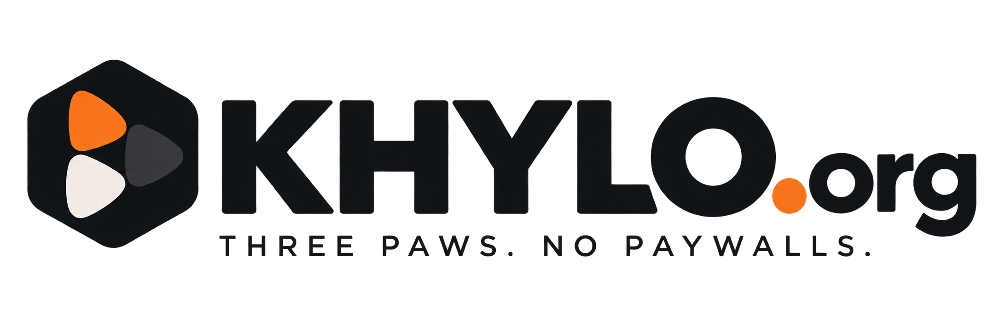

<p align="center">
  
</p>

<h1 align="center">Khylo for Android TV</h1>

<p align="center">
  Khylo for Google TV and Android TV, designed from scratch for the big screen and the remote.<br>
  It connects to your own <a href="https://github.com/khylo-org/khylo">Khylo Server</a>.
</p>

<!-- khylo-downloads:tv -->
<p align="center">
<a href="https://github.com/khylo-org/khylo/releases/download/DEV-V26.11.11.01/khylo-tv.apk"></a>
</p>

<p align="center">Needs a Khylo Server to connect to. <a href="https://github.com/khylo-org/khylo/blob/main/Install/android-tv.md">How to install it on your TV</a></p>
<!-- /khylo-downloads -->

<!-- khylo-downloads:nav -->
<p align="center"><b>Khylo</b> &nbsp;|&nbsp; <a href="https://github.com/khylo-org/khylo">Downloads and install guides</a> · <a href="https://github.com/khylo-org/khylo-server">Server code</a> · <a href="https://github.com/khylo-org/khylo-web">Web app code</a> · <a href="https://github.com/khylo-org/khylo-androidtv">Android TV app</a> · <a href="https://github.com/khylo-org/khylo/blob/main/CHANGELOG.md">What's new</a></p>
<!-- /khylo-downloads -->

---

## Highlights

- **A cinematic interface.** Full-screen artwork, our own intro, and a simple top bar: Home, Live TV, Khylo TV, Movies, TV Shows, and More.
- **Movies and TV Shows** in clean tabs: Recommended, Browse, Collections, Playlists and Categories.
- **A premium video player.** Real seeking, subtitles, audio tracks, quality, a sleep timer, favorites, Skip Intro / Recap / Credits (or auto-skip), and an Up Next countdown.
- **Live TV and Khylo TV** with a real guide and Multi View.
- **Music, audiobooks and books,** each with its own player or reader.
- **Home and kids profiles,** with sign-in by code or QR code. No typing passwords on a remote.
- **Back takes you back** to exactly where you were, and the app keeps the TV awake while video plays.

## Install it

Use the download button above, then follow the [Android TV install guide](https://github.com/khylo-org/khylo/blob/main/Install/android-tv.md).
You also need a Khylo Server: get one from the [downloads](https://github.com/khylo-org/khylo).

## Building it yourself

**You need:** JDK 21 and the Android SDK.

```bash
./gradlew assembleDebug      # debug build, installs next to a release build
./gradlew assembleRelease    # signed release build
```

Release builds are signed with your own keystore, passed in through environment variables. Keep the keystore and its passwords out of the repository.

| Variable | What it is |
| --- | --- |
| `KEYSTORE_FILE` | Path to the keystore |
| `KEYSTORE_PASSWORD` | Keystore password |
| `SIGNING_KEY_ALIAS` | Key alias |
| `SIGNING_KEY_PASSWORD` | Key password |

The server's client library lives in [`sdk/`](sdk) and the video decoder in [`third_party/`](third_party).

### Build number

The build number shown in **Settings, About** comes from `khylo.build` in `gradle.properties`, in the form `DEV-V<year>.<month>.<day>.<build of the day>`, for example `DEV-V26.11.02.01`.

## Contributing, security and license

[Contributing](CONTRIBUTING.md) &middot; [Security](SECURITY.md) &middot; [Code of conduct](CODE_OF_CONDUCT.md)

Khylo is free software under the [GNU General Public License v2](LICENSE). It is built on open-source components, including the Jellyfin project, whose copyright notices are kept in the source files as the license requires. See [NOTICE.md](NOTICE.md).
